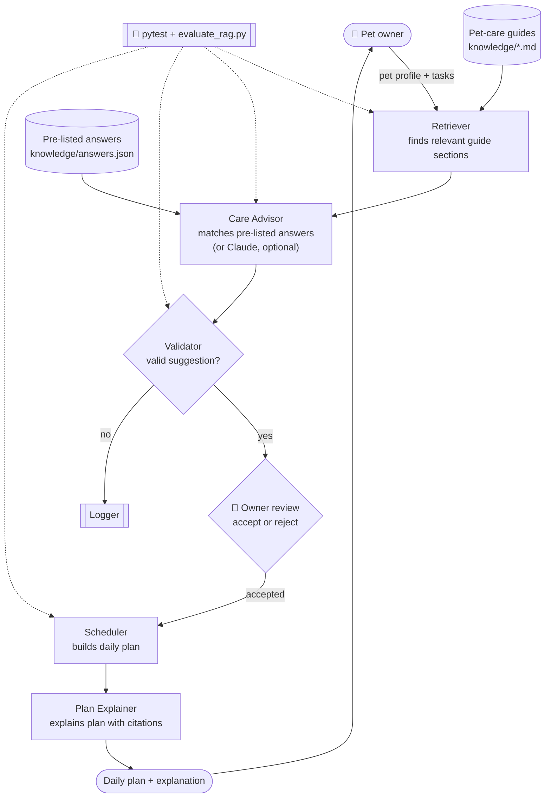

# 🐾 PawPal+ AI Care Advisor

**A pet-care planner that searches trusted care guides to suggest the tasks your pets are missing, builds a daily schedule around your time, and explains each decision with a source.**

The idea I had was that busy pet owners don't always know what care their pet actually needs at a given life stage or with a given condition. A senior cat with a thyroid condition needs different things from a young dog. PawPal+ looks up guidance for each pet's species, age and special needs, matches the pet to pre-listed care answers backed by that guidance, and lets the owner decide what to add. Every suggestion and explanation names the guide it came from, so the owner can check where the advice came from.

## Where this started: PawPal+ (Module 2)

This project extends **PawPal+**, PawPal+ was a Streamlit app that helps a busy owner stay consistent with pet care. The owner enters their pets, care tasks (walks, feeding, meds, grooming), and how much time they have. A rule-based scheduler then builds a daily plan that always includes required tasks like medication, ranks the rest by priority, honors preferred times, handles daily and weekly repeats, and warns about time conflicts. It explained its choices with fixed rules ("required, at your preferred time"), but it could only schedule tasks the owner already knew to add.

This version adds **Retrieval-Augmented Generation (RAG)**, so PawPal+ can also tell the owner *what* their pet needs, grounded in a knowledge base, and not just *when* to do it. The new AI feature is RAG combined with a reliability harness: retrieved guide sections ground every suggestion (drawn from pre-listed answers by default, or written by Claude in the optional Claude mode), and a validator, an evaluation script, confidence scores and logging check every suggestion before it reaches the owner.

---

## Architecture Overview



The diagram source is [diagrams/rag_system.mmd](diagrams/rag_system.mmd). Data flows from top to bottom:

1. **Input:** the owner's pet profile (species, age, special needs, existing tasks). There are two knowledge sources in [knowledge/](knowledge/):
   - 12 pet-care guides, split into 41 sections
   - [answers.json](knowledge/answers.json): 27 pre-listed care answers, each a ready-made task tied to the guide section it comes from
2. **Retriever:** turns the pet profile into a search query and finds the most relevant guide sections with BM25 keyword ranking. It only returns guides for the pet's own species.
3. **Care Advisor:** matches the pet to pre-listed answers by species, life stage (puppy, adult, senior) and special needs (e.g. "thyroid", "diabetes", "arthritis"). Each answer gets a match confidence:
   - 0.9 if it's written for the pet's condition
   - 0.75 if it's written for its life stage
   - 0.6 if it's general care for the species

   Answers whose guide section the retriever also found rank higher. It returns up to 4 answers the pet doesn't already have. Optionally, Claude can write suggestions from the retrieved sections instead.
4. **Validator (guardrail):** drops any suggestion that cites a guide section that doesn't exist, repeats an existing task, or has invalid values (including a confidence outside 0–1). Rejections are logged.
5. **Owner review (human in the loop):** the owner sees each suggestion with its reason, source and confidence, and ticks the ones to add. Only accepted suggestions become real tasks.
6. **Scheduler:** the original PawPal+ rule-based scheduler builds the day's plan, now including any accepted tasks.
7. **Plan Explainer:** explains each scheduled task. If the task came from a pre-listed answer, it gives that answer's reason and guide source; otherwise it gives the scheduler's rule.
8. **Testing and evaluation:** 87 pytest tests cover the scheduler, retriever, answer bank, validator and fallbacks. [evaluate_rag.py](evaluate_rag.py) measures retrieval and suggestion quality on 8 test pets with known right answers.

If Claude mode is chosen but Claude can't be reached, the system falls back to the pre-listed answers.

| File | Role |
|------|------|
| [pawpal_system.py](pawpal_system.py) | Original PawPal+ core: `Owner`, `Pet`, `Task`, `Scheduler`, `DailyPlan` |
| [pawpal_rag.py](pawpal_rag.py) | RAG layer: knowledge loader, `Retriever`, `AnswerBank`, `CareAdvisor`, `validate_suggestions`, `PlanExplainer`, logging, optional Claude client |
| [app.py](app.py) | Streamlit UI, including the AI Care Advisor review step |
| [knowledge/](knowledge/) | The care guides (`*.md`) and the pre-listed answers (`answers.json`) |
| [demo_rag.py](demo_rag.py) | Terminal demo of the full RAG pipeline |
| [evaluate_rag.py](evaluate_rag.py) | Reliability evaluation: retrieval and suggestion quality on 8 test pets |
| [main.py](main.py) | Terminal demo of the original scheduler |
| [scripts/collect_evidence.sh](scripts/collect_evidence.sh) | Re-runs everything and saves the output to `evidence/` |
| [tests/](tests/) | `test_pawpal.py` (scheduler), `test_rag.py` (RAG layer), `test_evaluate.py` (evaluation metrics) |

---

## Setup Instructions

You need **Python 3.10 or newer** (developed on 3.14). **No API key or account is needed.**

1. **Clone the repo and enter the project folder:**
   ```bash
   git clone <your-repo-url>
   cd applied-ai-system-final
   ```
2. **Create and activate a virtual environment:**
   ```bash
   python -m venv .venv
   source .venv/bin/activate        # Windows: .venv\Scripts\activate
   ```
3. **Install dependencies** (`streamlit`, `pytest`, and `anthropic` for the optional Claude mode):
   ```bash
   pip install -r requirements.txt
   ```
4. **Run it** (from the project folder, with the virtual environment active):
   ```bash
   streamlit run app.py     # the web app (opens in your browser)
   python demo_rag.py       # terminal demo of the RAG pipeline
   python evaluate_rag.py   # reliability evaluation
   python main.py           # terminal demo of the original scheduler
   python -m pytest         # run all 87 tests
   ```

Logs are written to `logs/pawpal.log`.

**Using the app:** add a pet under **Pets** (e.g. Mia, cat, 11, special needs `senior, thyroid condition`), then click **Get care suggestions** under **AI Care Advisor**, leaving **Pre-listed answers** selected. Tick the suggestions you want, click **Add selected tasks**, then click **Generate schedule** to see the plan and the cited explanation.

**Optional: Claude mode.** With an Anthropic API key from https://console.anthropic.com (paid, and separate from a claude.ai subscription), Claude can write the suggestions instead:
```bash
export ANTHROPIC_API_KEY="sk-ant-..."
streamlit run app.py               # then choose "Claude" under AI Care Advisor
python demo_rag.py --claude
python evaluate_rag.py --claude
```
If Claude is chosen but unavailable, the app says why and uses the pre-listed answers.

---

## Reproducible Execution Evidence

Everything below is copied from real runs:

```bash
bash scripts/collect_evidence.sh      
```

| Evidence file | Command | What it shows |
|---------------|---------|---------------|
| [evidence/01_tests.txt](evidence/01_tests.txt) | `python -m pytest -v` | All 87 tests by name, all passing |
| [evidence/02_evaluate_rag.txt](evidence/02_evaluate_rag.txt) | `python evaluate_rag.py` | Reliability metrics on 8 test pets |
| [evidence/03_demo_rag.txt](evidence/03_demo_rag.txt) | `python demo_rag.py` | Full pipeline: inputs → retrieval → suggestions → schedule before/after → cited explanation → guardrail check |
| [evidence/04_scheduler_main.txt](evidence/04_scheduler_main.txt) | `python main.py` | The original PawPal+ scheduler with conflicts and skipped tasks |

Each file starts with the command, the date and the Python version. No API key was used.


### 1. Automated tests

**Command:** `python -m pytest -v`

**Output** (shortened; full list in [evidence/01_tests.txt](evidence/01_tests.txt)):
```
collecting ... collected 87 items

tests/test_evaluate.py::test_answer_bank_eval_scores_every_case PASSED
tests/test_pawpal.py::test_mark_complete_changes_task_status PASSED
...
tests/test_rag.py::test_validator_rejects_bad_suggestions[overrides0-unknown source] PASSED
tests/test_rag.py::test_accepted_suggestion_changes_the_schedule PASSED
tests/test_rag.py::test_every_pre_listed_answer_is_valid_and_cites_a_real_guide PASSED
tests/test_rag.py::test_answer_bank_never_gives_medication_to_a_healthy_pet[dog] PASSED
tests/test_rag.py::test_explainer_cites_pre_listed_answers_without_claude PASSED
...
============================== 87 passed in 0.05s ==============================
```

### 2. Reliability evaluation

**Command:** `python evaluate_rag.py`

**Input:** 8 test pets with a known correct guide and expected task (defined in `eval_cases()` in [evaluate_rag.py](evaluate_rag.py)).

**Output** (shortened; full run in [evidence/02_evaluate_rag.txt](evidence/02_evaluate_rag.txt)):
```
Retrieval (expected guide in top 3)
  PASS  Senior cat, thyroid                expected cat_thyroid.md, got ['cat_thyroid.md', 'cat_senior.md', 'cat_thyroid.md']
  PASS  Diabetic cat                       expected cat_diabetes.md, got ['cat_general.md', 'cat_diabetes.md', 'cat_diabetes.md']
  PASS  Arthritic senior dog               expected dog_senior.md, got ['dog_senior.md', 'dog_senior.md', 'dog_senior.md']
  PASS  Puppy                              expected dog_puppy.md, got ['dog_puppy.md', 'dog_puppy.md', 'dog_puppy.md']
  PASS  Diabetic dog                       expected dog_diabetes.md, got ['dog_diabetes.md', 'dog_general.md', 'dog_general.md']
  PASS  Rabbit                             expected rabbit_care.md, got ['rabbit_care.md', 'rabbit_care.md', 'rabbit_care.md']
  PASS  Healthy adult dog, full routine    expected dog_general.md, got ['dog_general.md', 'dog_general.md', 'dog_senior.md']
  PASS  Healthy adult cat                  expected cat_general.md, got ['cat_general.md', 'cat_general.md', 'cat_general.md']

Care Advisor: pre-listed answers (27 in knowledge/answers.json), 2 run(s) per case
  Senior cat, thyroid                ['Thyroid medication', 'Weekly weigh-in', 'Gentle play session', 'Gentle brushing']
  Diabetic cat                       ['Insulin (morning)', 'Insulin (evening)', 'Log water and appetite', 'Brushing']
  Arthritic senior dog               ['Joint supplement', 'Short gentle walk', 'Gentle stretching', 'Dinner']
  Puppy                              ['Potty break', 'Midday meal', 'Puppy training', 'Brushing']
  Diabetic dog                       ['Insulin (morning)', 'Insulin (evening)', 'Dinner', 'Evening walk']
  Rabbit                             ['Refill hay and water', 'Leafy greens', 'Supervised playtime', 'Spot-clean litter area']
  Healthy adult dog, full routine    ['Tooth brushing']
  Healthy adult cat                  ['Play session', 'Brushing', 'Scoop litter box', 'Tooth brushing']
  ...

Summary
  Retrieval hit rate:         8/8 (100%)
  Suggestion source:          pre-listed answers (27 in knowledge/answers.json)
  Expected task suggested:    100%
  Meds hallucination rate:    0% (healthy pets given meds)
  Guardrail pass rate:        100% (0 rejected)
  Average confidence:         0.76
  Consistent across runs:     8/8 cases
  Errors:                     0/16 runs
```

### 3. End-to-end pipeline and guardrails

**Command:** `python demo_rag.py`

**Input:** owner Jordan, 120 minutes from 07:00. Mia: cat, 11, `senior, thyroid condition`, tasks Breakfast and Puzzle feeder. Rex: dog, 10, `arthritis`, tasks Breakfast and a 40-minute Morning walk.

**Output** (shortened; full run in [evidence/03_demo_rag.txt](evidence/03_demo_rag.txt)):
```
Schedule BEFORE suggestions:
  07:00  Mia: Breakfast (5 min, high)
  07:15  Rex: Breakfast (10 min, high)
  07:30  Rex: Morning walk (40 min, high)
  08:10  Mia: Puzzle feeder (15 min, low)

Pet: Mia (cat, 11 yr, needs: senior, thyroid condition)
Retrieved guide sections:
  - cat_thyroid.md > Thyroid medication
  - cat_senior.md > When a cat is senior
  - cat_thyroid.md > Vet follow-up
  - cat_general.md > Play and enrichment
  - cat_senior.md > Grooming help for senior cats

Pet: Rex (dog, 10 yr, needs: arthritis)
Retrieved guide sections:
  - dog_senior.md > Exercise for senior dogs
  - dog_senior.md > Senior feeding
  - dog_senior.md > Health checks
  - dog_senior.md > Arthritis and joint care
  - dog_general.md > Daily exercise
...
Guardrail check: 1 good + 3 bad suggestions for Mia (no AI needed)
  accepted: ['Thyroid meds']
  rejected: Breakfast: duplicates an existing task
  rejected: Daily vitamin injection: cites unknown source 'vitamins.md#injections'
  rejected: Weekly weigh-in: duration 0 min is out of range
```

The same rejections are written to the log:
```
WARNING pawpal.rag: Rejected suggestion for Mia: Daily vitamin injection: cites unknown source 'vitamins.md#injections'
```

### 4. Reliability and guardrail results at a glance

| Check | Result | Evidence |
|-------|--------|----------|
| Automated tests | **87 / 87 pass** | `01_tests.txt` |
| Retrieval: right guide in top 3 | **8 / 8 test pets** | `02_evaluate_rag.txt` |
| Expected task suggested | **7 / 7 pets that have one** | `02_evaluate_rag.txt` |
| Medication suggested for a healthy pet | **0%** | `02_evaluate_rag.txt` |
| Same answer on repeated runs | **8 / 8 cases** | `02_evaluate_rag.txt` |
| Validator catches planted bad suggestions | **3 / 3 rejected, 1 / 1 good one kept** | `03_demo_rag.txt` |
| Every pre-listed answer is valid and cites a real guide | **27 / 27** (unit test) | `01_tests.txt` |
| Claude mode unavailable | Falls back to the pre-listed answers, says why, logs it (unit test) | `01_tests.txt` |


---

## Sample Interactions

All examples use the sample owner in [demo_rag.py](demo_rag.py): Jordan has 120 minutes from 07:00, a senior cat named Mia and a senior dog named Rex. Run `python demo_rag.py` to reproduce them.

Starting schedule (from the original scheduler, before any suggestions):
```
07:00  Mia: Breakfast (5 min, high)
07:15  Rex: Breakfast (10 min, high)
07:30  Rex: Morning walk (40 min, high)
08:10  Mia: Puzzle feeder (15 min, low)
```

### Example 1: Care suggestions for a senior cat with a thyroid condition

**Input:** Mia, cat, 11 years, special needs `senior, thyroid condition`. Current tasks: Breakfast, Puzzle feeder.

**Retrieval** (deterministic, so you'll get the same result):
```
Query: cat senior senior senior thyroid condition thyroid condition thyroid condition
       Breakfast feeding Puzzle feeder enrichment daily care exercise feeding
Retrieved guide sections:
  - cat_thyroid.md > Thyroid medication
  - cat_senior.md > When a cat is senior
  - cat_thyroid.md > Vet follow-up
  - cat_general.md > Play and enrichment
  - cat_senior.md > Grooming help for senior cats
```

**Output (Care Advisor):**
```
Suggestions (from pre-listed answers):
  + Thyroid medication (meds, 5 min, high, daily, required)
      why: Thyroid medication is given daily at consistent times and should never be skipped.
      source: cat_thyroid.md > Thyroid medication  (confidence 0.90)
  + Weekly weigh-in (other, 5 min, medium, weekly)
      why: Weigh senior and hyperthyroid cats weekly; weight loss can be an early sign of illness.
      source: cat_thyroid.md > Weight and appetite monitoring  (confidence 0.90)
  + Gentle brushing (grooming, 10 min, low, weekly)
      why: Senior cats groom themselves less well, so gentle brushing 2 to 3 times a week helps.
      source: cat_senior.md > Grooming help for senior cats  (confidence 0.75)
  + Gentle play session (enrichment, 10 min, medium, daily)
      why: Senior cats still need daily activity: short, gentle play sessions of 5 to 10 minutes.
      source: cat_senior.md > Gentle play for senior cats  (confidence 0.75)
```
The thyroid answers score 0.9 because they match her condition. The senior answers score 0.75 because they match her life stage.

### Example 2: Suggestions for an arthritic senior dog, and the schedule change

**Input:** Rex, dog, 10 years, special needs `arthritis`. Current tasks: Breakfast, a 40-minute Morning walk.

**Retrieval:**
```
Query: dog senior senior senior arthritis arthritis arthritis Breakfast feeding
       Morning walk walk daily care exercise feeding
Retrieved guide sections:
  - dog_senior.md > Exercise for senior dogs
  - dog_senior.md > Senior feeding
  - dog_senior.md > Health checks
  - dog_senior.md > Arthritis and joint care
  - dog_general.md > Daily exercise
```

**Output (Care Advisor):**
```
Suggestions (from pre-listed answers):
  + Joint supplement (meds, 5 min, high, daily)
      why: Dogs with arthritis often get a vet-approved joint supplement daily with a meal.
      source: dog_senior.md > Arthritis and joint care  (confidence 0.90)
  + Short gentle walk (walk, 15 min, medium, daily)
      why: Senior or stiff dogs do better with two or three short, gentle walks than one long one.
      source: dog_senior.md > Exercise for senior dogs  (confidence 0.90)
  + Gentle stretching (enrichment, 10 min, medium, daily)
      why: Gentle range-of-motion stretching for 5 to 10 minutes can help stiff joints.
      source: dog_senior.md > Arthritis and joint care  (confidence 0.90)
  + Dinner (feeding, 10 min, high, daily at 18:30, required)
      why: Adult dogs should eat twice a day at consistent times, 8 to 12 hours apart.
      source: dog_general.md > Feeding schedule  (confidence 0.75)
```

**The schedule after accepting both pets' suggestions, with the cited explanation** (the demo accepts all of them; in the app the owner picks). Required tasks such as Thyroid medication and Dinner always fit, and two low-priority tasks no longer fit in 120 minutes:
```
Schedule AFTER accepting suggestions:
  07:00  Mia: Breakfast (5 min, high)
  07:05  Mia: Thyroid medication (5 min, high)
  07:10  Rex: Joint supplement (5 min, high)
  07:15  Rex: Breakfast (10 min, high)
  07:30  Rex: Morning walk (40 min, high)
  08:10  Rex: Short gentle walk (15 min, medium)
  08:25  Mia: Weekly weigh-in (5 min, medium)
  08:30  Mia: Gentle play session (10 min, medium)
  08:40  Rex: Gentle stretching (10 min, medium)
  18:30  Rex: Dinner (10 min, high)
  skipped Mia: Gentle brushing (10 min, low): needs 10 min, only 5 min left
  skipped Mia: Puzzle feeder (15 min, low): needs 15 min, only 5 min left

Explanation, with sources (from pre-listed answers):
Plan for Tuesday, November 17: 10 task(s), 115 min. 7 of them come from the care guides, with the source shown.
- 07:00 Mia: Breakfast (5 min, high): Required, at your preferred time
- 07:05 Mia: Thyroid medication (5 min, high): Thyroid medication is given daily at consistent times
  and should never be skipped. (required, fits in your available time) [cat_thyroid.md > Thyroid medication]
- 08:10 Rex: Short gentle walk (15 min, medium): Senior or stiff dogs do better with two or three short,
  gentle walks than one long one. (medium priority, fits in your available time) [dog_senior.md > Exercise for senior dogs]
...
- Skipped Mia: Puzzle feeder (15 min, low): Needs 15 min, only 5 min left
```

### Example 3: Guardrails catching bad suggestions

This is reproduced by the last section of `python demo_rag.py`.

**Input:** four suggestions given to the validator for Mia: one good, and three with the kinds of mistakes a model or a typo in `answers.json` could produce.

**Output:**
```
Guardrail check: 1 good + 3 bad suggestions for Mia (no AI needed)
  accepted: ['Thyroid meds']
  rejected: Breakfast: duplicates an existing task
  rejected: Daily vitamin injection: cites unknown source 'vitamins.md#injections'
  rejected: Weekly weigh-in: duration 0 min is out of range
```
The made-up "vitamin injection" is the most important catch. It cites a guide that doesn't exist, so it never reaches the owner. The same rejections are written to `logs/pawpal.log`.

---

## Design Decisions

| Decision | Why | Trade-off |
|----------|-----|-----------|
| **Pre-listed answers as the default.** Suggestions come from 27 hand-written answers in `answers.json`, each tied to a guide section. | Free, works offline with no account, gives the same result every time (so it's fully testable), and every answer was checked by a person before it ships. It can never invent a medication. | Only covers what's written in `answers.json`; a new condition means writing new answers. It can't adapt its wording to an unusual pet. |
| **Claude kept as an option.** | For pets the answer bank doesn't cover, Claude can write suggestions from the retrieved guides. The same validator checks its output. | Needs a paid API key. Its output varies between runs, so it's checked with `evaluate_rag.py --claude` rather than exact tests. |
| **Retrieval still matters with pre-listed answers.** | The retriever finds the guide sections for each pet. Answers whose section it also found rank higher, and the sections are shown to the owner. | Two ways to judge relevance (answer matching rules and BM25 search) that have to stay consistent. |
| **Match confidence by how specific the answer is** (condition 0.9, life stage 0.75, general 0.6). | Easy to explain to an owner, and it ranks condition-specific care first. | Fixed numbers, not learned from data. |
| **RAG suggests tasks, not just text.** Accepted suggestions become real `Task` objects that go into the scheduler. | The retrieved guidance should change what the system *does*, not just add a paragraph beside the plan. | Needs a strict validator, since a bad suggestion could otherwise end up in the schedule. |
| **The owner approves every suggestion.** | It's pet health. The owner knows the vet's instructions and the pet; the guides are general. | One extra click. |
| **Code builds the schedule; the answers (or Claude) only suggest and explain.** The original rule-based scheduler still decides times. | Scheduling has hard rules (required meds always fit, no overlaps) that tested code handles reliably. | Explanations can only describe the plan; they can't improve it. |
| **BM25 keyword search instead of embeddings.** | No extra API or vector database, results are deterministic (so they're testable), and the knowledge base is small and uses consistent vocabulary. | Misses synonyms ("hyperthyroid" vs "thyroid condition"). Embeddings would scale better to a large, messy knowledge base. |
| **A small, hand-written knowledge base.** | I control its quality and scope, and file names tag the species, so dog advice never reaches a cat. | Covers only common cases. It isn't veterinary-grade and needs manual updates. |
| **A citation for every suggestion.** | Makes every suggestion machine-checkable: the validator confirms it points to a real guide section, whether it came from the answer bank or Claude. | Answers must be written in a fixed format. |
| **Claude sits behind a small `LLMClient` interface.** | Tests swap in a fake Claude, so the optional Claude mode is tested offline and for free. | The real API call itself isn't covered by automated tests. |
| **Fail safe, never crash.** In Claude mode, a missing key, network error, refusal or malformed reply falls back to the pre-listed answers. A broken entry in `answers.json` is skipped at startup. Every error is logged. | The planner should work even when Claude doesn't. | The owner may get the simpler suggestions, so the app shows a notice. |
| **Life stage and special needs are weighted more heavily in the search query.** | Without it, generic words like "feeding" outranked the condition that matters (see Testing). | Hand-tuned weights, chosen by testing on example pets rather than learned from data. |

---

## Testing Summary

**Results in brief:**
- **All 87 automated tests pass** (`python -m pytest`, under 0.1 s, no API key needed).
- **Retrieval found the right guide in the top 3 for 8 of 8 test pets.** Before I gave extra weight to life stage and special needs, it missed the diabetes guide's insulin section for a diabetic cat and gave a puppy the diabetes guide first.
- **The validator caught 3 of 3 deliberately bad suggestions:** an invented source, a duplicate task, and a 0-minute task.
- **The evaluation suggested the expected task for every test pet that had one, never gave medication to a healthy pet, and gave the same answer on every repeated run.** Average match confidence was 0.76.

I measure reliability in four ways:

### 1. Automated tests (87, all passing)

```
tests/test_evaluate.py ...                                               [  3%]
tests/test_pawpal.py ....................................                [ 44%]
tests/test_rag.py ................................................       [100%]
============================== 87 passed ==============================
```

- **Scheduler (36 tests, from the original PawPal+):** sorting, required tasks and priority under a tight time budget, preferred times, daily and weekly recurrence (including month, year and leap-day boundaries), conflict detection, empty states, and saving and loading.
- **Retrieval:** the right guide for a thyroid cat, diabetic cat, arthritic dog, puppy and rabbit; never another species' guide; nothing for an unrelated query.
- **Guardrails:** the validator rejects invented sources, bad durations, categories, frequencies and times, missing titles or reasons, confidence outside 0–1, duplicates, and more than 4 suggestions. The explainer drops invented citations.
- **Pre-listed answers:** every answer is valid and cites a real guide section (a broken one is skipped), conditions and life stages match the right answers, a healthy dog, cat or rabbit never gets medication, and tasks the pet already has aren't suggested again.
- **Behavior:** **an accepted suggestion changes the schedule**, the explanation cites the right guide, and when Claude mode fails it falls back to the pre-listed answers. With a fake Claude, its suggestions are validated the same way.
- **The evaluation script's own math** is tested, so the numbers it reports can be trusted.

### 2. Evaluation script ([evaluate_rag.py](evaluate_rag.py))

It runs 8 test pets with known right answers: a thyroid cat, diabetic cat, arthritic senior dog, puppy, diabetic dog, rabbit, and healthy adult dog and cat. It runs each case twice and reports:

| Metric | What it checks |
|--------|----------------|
| Retrieval hit rate | The expected guide is in the top 3 results |
| Expected-task rate | The suggestions include what the guide says this pet needs (e.g. insulin for a diabetic pet) |
| Medication hallucination rate | Medication suggested for a pet with no medical condition (should be 0%) |
| Guardrail pass rate | Share of suggestions that pass validation |
| Average confidence | How specifically the suggestions match the pet (0–1) |
| Consistency | Cases where repeated runs agree on whether the expected task was found |

Results (`python evaluate_rag.py`, no API key needed; full run in [evidence/02_evaluate_rag.txt](evidence/02_evaluate_rag.txt)):
```
Summary
  Retrieval hit rate:         8/8 (100%)
  Suggestion source:          pre-listed answers (27 in knowledge/answers.json)
  Expected task suggested:    100%
  Meds hallucination rate:    0% (healthy pets given meds)
  Guardrail pass rate:        100% (0 rejected)
  Average confidence:         0.76
  Consistent across runs:     8/8 cases
  Errors:                     0/16 runs
```
`python evaluate_rag.py --claude` runs the same evaluation on Claude's suggestions if you have an API key.

### 3. Confidence scoring

Every suggestion carries a 0–1 confidence: 0.9 if the answer is written for the pet's condition, 0.75 for its life stage, 0.6 for general care. Higher-confidence answers are suggested first, the score appears in the app next to each suggestion so the owner can weigh it, and the evaluation script reports the average. In Claude mode, Claude rates its own suggestions instead. The validator rejects scores outside 0–1.

### 4. Logging, error handling and human review

- **Logging:** `logs/pawpal.log` records every search query with the sections found and their scores, which answers matched each pet, each rejected suggestion with the reason, and every error. In Claude mode it also records each model call (model, stop reason, token counts, request id).
- **Error handling:** a broken entry in `answers.json` is skipped at startup and logged. In Claude mode, a missing key, network failure, API error, refusal or malformed reply falls back to the pre-listed answers instead of crashing. I also ran the full Streamlit flow headlessly with Streamlit's `AppTest`.
- **Human review:** the owner approves every suggestion before it becomes a task, with its reason, source and confidence shown.

### What I learned

- **Test retrieval on its own, with expected answers.** When RAG gives a bad answer, the cause is often that it retrieved the wrong context, not that the model is bad. My retrieval bugs only showed up once I wrote down which guide each pet should get.
- **Run the failure paths for real.** With no API key, the SDK raised a plain `TypeError` instead of an API error, which my error handling missed. I only found it by actually running without a key.
- **Know what the numbers don't prove.** I wrote the answers, the test pets and the matching rules, so 100% on my own 8 pets is expected; pets unlike them may do worse. The evaluation proves the system does what I designed, not that the advice is complete. That's what the vet disclaimer and owner review are for.

---

## Portfolio

- **Code:** https://github.com/K-Dimitrijevic/ai110-module2show-pawpal-starter
- **What this project says about me as an AI engineer:**

  > ✏️ *Draft. Rewrite this in your own words.*
  >
  > I build AI features that can be checked, not just demoed. In PawPal+ every suggestion has to cite a real guide section that a validator confirms, the rules that must never break (medication always gets scheduled) live in tested code, and pre-listed answers make the core feature free, consistent and fully testable, with a language model available as an option. I measure before I trust: a retrieval bug that gave a puppy the diabetes guide only turned up because I wrote down the right answer for each test pet and checked it. I also keep a person in charge of decisions that matter, like what goes into a pet's care routine. To me, a good AI engineer cares less about getting the model to say something impressive and more about knowing when it's wrong, and making sure the system still works when it is.

---

## Reflection

> ✏️ *Draft. Rewrite this in your own words before submitting.*

This project taught me that most of the work in an AI feature is around the core step: choosing what to retrieve, deciding what the system is allowed to suggest, and checking every suggestion before it reaches a person. Building the answer bank made that clear: once each answer was tied to a guide section, the validator, tests and evaluation could check it automatically, and the same checks work on Claude's output. On problem-solving: I found more bugs by writing down what the system should do (for example, "a diabetic cat should get the insulin guide") and testing that directly than by reading output and deciding it looked fine.

*The responsible-AI reflection (how I worked with AI, suggestions I accepted and rejected, and limitations) is in [model_card.md](model_card.md). The design reflection for the original scheduler is in [reflection.md](reflection.md).*

---

> PawPal+ suggestions come from general pet-care guides and are not a substitute for advice from a veterinarian.
