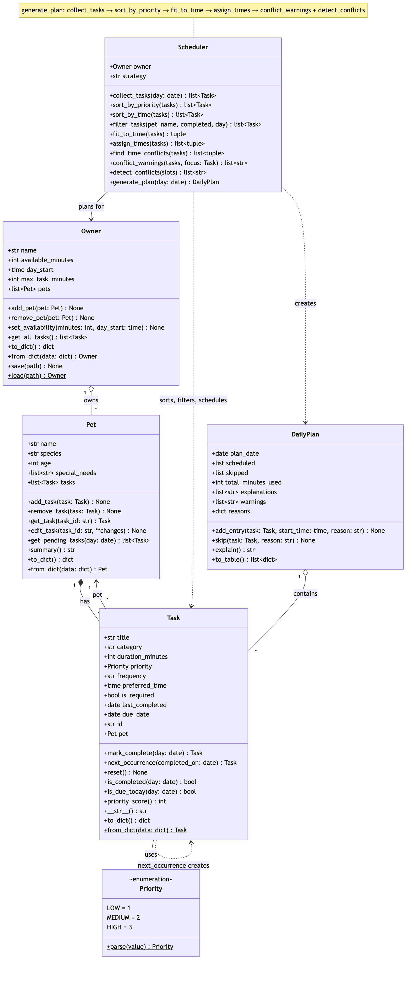

# PawPal+ (Module 2 Project)

You are building **PawPal+**, a Streamlit app that helps a pet owner plan care tasks for their pet.

## Scenario

A busy pet owner needs help staying consistent with pet care. They want an assistant that can:

- Track pet care tasks (walks, feeding, meds, enrichment, grooming, etc.)
- Consider constraints (time available, priority, owner preferences)
- Produce a daily plan and explain why it chose that plan

Your job is to design the system first (UML), then implement the logic in Python, then connect it to the Streamlit UI.

## What you will build

Your final app should:

- Let a user enter basic owner + pet info
- Let a user add/edit tasks (duration + priority at minimum)
- Generate a daily schedule/plan based on constraints and priorities
- Display the plan clearly (and ideally explain the reasoning)
- Include tests for the most important scheduling behaviors

## Getting started

### Setup

```bash
python -m venv .venv
source .venv/bin/activate  # Windows: .venv\Scripts\activate
pip install -r requirements.txt
```

### Suggested workflow

1. Read the scenario carefully and identify requirements and edge cases.
2. Draft a UML diagram (classes, attributes, methods, relationships).
3. Convert UML into Python class stubs (no logic yet).
4. Implement scheduling logic in small increments.
5. Add tests to verify key behaviors.
6. Connect your logic to the Streamlit UI in `app.py`.
7. Refine UML so it matches what you actually built.

## ✨ Features

- **Priority-based planning.** Required tasks (like meds) always make it into the plan, even if they go over your time budget. You'll get a warning when that happens. Everything else is picked by priority, and if two tasks tie, meds beat feeding, feeding beats walks, and then the shorter task goes first.
- **Time budget and task limit.** The plan stays within the minutes you have available. Tasks that don't fit, or that are longer than your "longest task" setting, are skipped, and the plan tells you why.
- **Preferred times.** A task with a preferred time is scheduled at that time, or as soon after as possible if something else is already there. Flexible tasks fill the open time around them. Anything that would start after midnight is left out.
- **Sorting by time.** Task lists are shown earliest first. Tasks with no set time go at the end, with the most important ones first.
- **Filtering.** You can narrow the task list to one pet, to what's still due today, or to what you've already finished today. Pet names aren't case sensitive.
- **Daily and weekly recurrence.** Marking a task done creates the next one automatically: tomorrow for daily tasks, a week later for weekly ones. If you miss a task, it stays on your list until you do it, and marking something done twice doesn't create a duplicate.
- **Conflict warnings.** If two tasks want overlapping time, for the same pet or for different pets, PawPal+ warns you instead of quietly dropping one. It checks the whole time window, not just the start time, so a 5-minute supplement at 7:45 gets flagged against a 7:30 to 8:00 walk. Tasks that end right as the next one starts are fine.
- **Explanations.** Every scheduled or skipped task comes with a short reason, like "required, at your preferred time" or "longer than your 45-minute task limit".
- **Saves your data.** Your pets and tasks are saved to `pawpal_data.json`, so they're still there next time you open the app.

## 🛠️ Implementation Summary

The scheduling logic lives in `pawpal_system.py`, with a terminal demo in `main.py` (`python main.py`) and tests in `tests/`. The final class diagram is in `diagrams/uml_final.mmd` (Mermaid source), exported below as `diagrams/uml_final.png`.



| Class | Responsibility |
|-------|----------------|
| `Task` | One care activity: title, category, duration, `Priority` (low/medium/high), frequency (daily/weekly), optional preferred time, whether it's required, and when it was last completed. Knows whether it is due on a given day and gives a priority score for sorting. |
| `Pet` | A pet's details and its list of tasks. Adding a task links the task back to the pet. |
| `Owner` | The owner's constraints (available minutes, when the day starts, longest task they'll accept) and their pets. `get_all_tasks()` returns every pet's tasks in one list. |
| `Scheduler` | Builds the plan. Gets its tasks only through `Owner.get_all_tasks()`, so it works across all pets. |
| `DailyPlan` | The result: scheduled tasks with start times, skipped tasks with reasons, warnings, and a readable explanation. `to_table()` returns rows for display. |

**How the classes work together:** `Scheduler.generate_plan(day)` runs five steps, each taking the previous step's output:

1. **Collect:** tasks due today, from all pets, via `owner.get_all_tasks()`.
2. **Sort:** required tasks first, then by priority score, then shortest first.
3. **Fit:** keep tasks while time remains. Required tasks are always kept, and anything longer than the owner's task limit is skipped.
4. **Assign times:** start at the owner's `day_start`, place tasks with a preferred time at that time (or as soon after as possible), and fill gaps with flexible tasks.
5. **Check:** warn about overlapping preferred times, an over-budget plan, moved preferred times, or tasks running past midnight.

Every scheduled or skipped task is recorded in the `DailyPlan` with a plain-language reason, which is how the app explains its choices.

## 🖥️ Sample Output

This is the daily plan `python main.py` prints for the sample owner (Jordan, with a dog named Rex and a cat named Mia). Some of the sample tasks clash on purpose so the conflict warnings show up.

```
============================================================
Today's Schedule for Jordan - Sunday, October 25, 2026
============================================================
Pets:
  - Rex (dog, 4 yr) - 5 task(s)
  - Mia (cat, 9 yr) - 5 task(s); needs: senior, thyroid condition

Time   Pet   Task             Min  Priority Why
------------------------------------------------------------
07:00  Mia   Breakfast          5  high     required, at your preferred time
07:05  Rex   Breakfast         10  high     required, as close to 07:00 as possible
07:15  Mia   Puzzle feeder     15  low      low priority, fits in your available time
07:30  Rex   Morning walk      30  high     high priority, at your preferred time
08:00  Rex   Joint supplement   5  high     high priority, as close to 07:45 as possible
08:05  Mia   Thyroid meds       5  high     required, as close to 08:00 as possible
08:10  Mia   Eye drops          5  high     high priority, as close to 08:00 as possible
08:15  Mia   Brushing          15  low      low priority, fits in your available time
18:00  Rex   Evening walk      30  medium   medium priority, at your preferred time
------------------------------------------------------------
Total: 120 of 120 available minutes

Skipped:
  - Rex: Long hike (60 min, medium): longer than your 45-minute task limit

Warnings:
  ! Time conflict, different pets: Mia: Breakfast (5 min, high) at 07:00-07:05 overlaps Rex: Breakfast (10 min, high) at 07:00-07:10.
  ! Time conflict, same pet (Rex): Rex: Morning walk (30 min, high) at 07:30-08:00 overlaps Rex: Joint supplement (5 min, high) at 07:45-07:50.
  ! Time conflict, same pet (Mia): Mia: Thyroid meds (5 min, high) at 08:00-08:05 overlaps Mia: Eye drops (5 min, high) at 08:00-08:05.
  ! Rex: Breakfast (10 min, high) moved from preferred 07:00 to 07:05.
  ! Rex: Joint supplement (5 min, high) moved from preferred 07:45 to 08:00.
  ! Mia: Thyroid meds (5 min, high) moved from preferred 08:00 to 08:05.
  ! Mia: Eye drops (5 min, high) moved from preferred 08:00 to 08:10.
```

## 🧪 Testing PawPal+

With the virtual environment activated (`source .venv/bin/activate`), run the full suite from the project root:

```bash
python -m pytest
```

I ran 36 tests that cover the behaviors that matter most to a pet owner, with both normal cases and edge cases:

- **Sorting:** tasks come back in chronological order with untimed tasks last, ties keep their order, and a 00:00 task sorts first. Planning order is required → priority → category (meds, feeding, walk) → shortest.
- **Fitting the time budget:** required tasks are always kept, even over budget, with a warning. Higher-priority tasks get time first, the budget can be filled exactly, tasks over the owner's length limit are skipped, and a 0-minute budget keeps only required tasks.
- **Start times:** preferred times are honored. Flexible tasks fill the gaps, and two tasks at the same time are placed one after the other with a "moved" warning. Tasks that would start after midnight are skipped with a reason.
- **Recurring tasks:** completing a daily task creates one due the next day, and a weekly task creates one due 7 days later. This works across month, year and leap-day boundaries. Missed tasks stay due, and completing a task twice makes no duplicate.
- **Conflict detection:** duplicate and overlapping times are flagged for the same pet and across pets. Back-to-back tasks aren't flagged, and bad data gives a warning instead of a crash.
- **Empty states and saving:** an owner with no pets, a pet with no tasks, or all tasks done gives an empty plan. Saving to JSON and loading back gives the same data.

Sample test output:

```
============================= test session starts ==============================
platform darwin -- Python 3.14.8, pytest-9.1.1, pluggy-1.7.0
configfile: pytest.ini
testpaths: tests
collected 36 items

tests/test_pawpal.py ....................................                [100%]

============================== 36 passed in 0.02s ==============================
```

In terms of "Confidence Level" about the system's reliability I give it a solid 4. There might be some bugs I may have missed when debugging. But I think regardless it will still function as is.

## 📐 Smarter Scheduling

| Feature | Method(s) | Notes |
|---------|-----------|-------|
| Task sorting | `Scheduler.sort_by_time()`, `Scheduler.sort_by_priority()` | By preferred time, earliest first; untimed tasks go last, highest priority first. Planning order is required → priority score → shortest. |
| Filtering | `Scheduler.filter_tasks()`, `Scheduler.fit_to_time()` | Filter by pet name (any case) and/or completed status on a day. When planning, tasks are skipped with a reason if time runs out or they exceed the owner's task limit. |
| Conflict handling | `Scheduler.find_time_conflicts()`, `Scheduler.conflict_warnings()` | Flags overlapping preferred time windows (not just same start time), for the same pet or different pets. Warns instead of crashing; `focus=task` checks one newly added task. |
| Recurring tasks | `Task.mark_complete()`, `Task.next_occurrence()`, `Task.is_due_today()` | Completing a daily/weekly task adds its next occurrence to the pet, due in 1 or 7 days. Missed tasks stay due; completing twice adds no duplicate. |

## 📸 Demo Walkthrough

### Running it

With the virtual environment activated:

```bash
streamlit run app.py   # the web app
python main.py         # the terminal demo
```

### What you can do in the app

The app is one page, split into four sections from top to bottom. 

- **Owner:** set your name, how many minutes you have today, what time your day starts, and the longest single task you're willing to do (0 means no limit).
- **Pets:** add a pet with a name, species, age, and any special needs. You can't add two pets with the same name.
- **Tasks:**
You are able to do all of the following tasks as mentioned below:
  - Add a task for any pet. Give it a title, category, duration, priority, and whether it repeats daily or weekly. You can also mark it as required or give it a preferred time.
  - If the new task overlaps something already planned, you'll see a yellow warning instead of the usual green "Added" message.
  - Any time conflicts for today are listed in a yellow box above the task list. The box stays there until you fix the times.
  - Use **Mark a task done** to check off something you've finished. The app tells you when the next one is due.
  - Use **Show pet** and **Show tasks** to filter the list by pet, and by whether a task is due today, done today, or either.
  - The task table is always sorted by time, and the Status column shows whether each task is due today, done, or coming up later.
- **Today's Schedule:**
  - Click **Generate schedule** to build the plan. You'll see three totals at the top: tasks scheduled, minutes used out of your budget, and tasks skipped.
  - Below that is a green message if everything fits, or yellow warnings for conflicts or going over budget.
  - Then come the plan itself, a blue note listing any tasks that were moved from their preferred time, and a table of skipped tasks with the reason for each.
  - **Full explanation** expands into the scheduler's reasoning for each task.
  - **Reset everything** clears all your data so you can start over.

### Example workflow

1. In **Owner**, set 90 minutes available and a day start of 07:00.
2. In **Pets**, add Rex (dog, 4) and Mia (cat, 9, special needs "senior").
3. In **Tasks**, add these:
   - "Breakfast" for Rex: feeding, 10 min, high, required, preferred time 07:00.
   - "Morning walk" for Rex: walk, 30 min, high, preferred time 07:30.
   - "Thyroid meds" for Mia: meds, 5 min, high, required, preferred time 07:45. This one overlaps the walk, so a yellow conflict warning appears right away.
   - "Puzzle feeder" for Mia: enrichment, 15 min, low, no preferred time.
4. Look at the task list. It's sorted 07:00, 07:30, 07:45, then the Puzzle feeder last, since it has no set time. Set **Show pet** to Mia to see only her two tasks.
5. Click **Generate schedule**:
   - Breakfast is at 07:00 and the walk at 07:30.
   - The Puzzle feeder fills the gap at 07:10.
   - The meds get pushed to 08:00 because the walk is still going. The blue "Moved tasks" note shows this, and the conflict warning explains why.
6. Mark Breakfast as done. The app says the next one is due tomorrow. Switch **Show tasks** to "Done today" to see it there, or to "All" to see tomorrow's copy waiting.

### Scheduler behaviors you'll see

- **Sorting:** the task list and the plan are both in time order, and flexible tasks are placed around the fixed ones.
- **Priority and required tasks:** when time is short, high-priority and required tasks get scheduled first, and the rest show up under Skipped with the minutes they needed.
- **Conflict warnings:** overlapping tasks are flagged with both time windows shown, and the warning says whether it's the same pet or two different pets. The scheduler keeps both tasks and moves the later one.
- **Recurrence:** finishing a daily task schedules it again for tomorrow, and a weekly one for next week.
- **Filtering:** the task list can be narrowed down by pet and by status.

### Terminal demo output

`main.py` runs the same scheduler without the UI. After printing the daily plan (which is shown under Sample Output above), it walks through sorting, recurrence, filtering, and conflict checks. Here's a shortened version of that part of the output (`...` marks where lines were cut):

```
============================================================
Sorting & Filtering Demo
============================================================
...
Sorted by time (untimed last, by priority):
  07:00  Rex: Breakfast (10 min, high)
  07:00  Mia: Breakfast (5 min, high)
  07:30  Rex: Morning walk (30 min, high)
  07:45  Rex: Joint supplement (5 min, high)
  08:00  Mia: Thyroid meds (5 min, high)
  08:00  Mia: Eye drops (5 min, high)
  18:00  Rex: Evening walk (30 min, medium)
  --:--  Rex: Long hike (60 min, medium)
  --:--  Mia: Puzzle feeder (15 min, low)
  --:--  Mia: Brushing (15 min, low)
...
Due today (Scheduler.collect_tasks):
  07:30  Rex: Morning walk (30 min, high)
  07:45  Rex: Joint supplement (5 min, high)
  08:00  Mia: Eye drops (5 min, high)
  18:00  Rex: Evening walk (30 min, medium)
  --:--  Rex: Long hike (60 min, medium)
  --:--  Mia: Puzzle feeder (15 min, low)
  --:--  Mia: Brushing (15 min, low)
...
Filter: pet_name='Rex', completed=False
  18:00  Rex: Evening walk (30 min, medium)
  --:--  Rex: Long hike (60 min, medium)
  07:30  Rex: Morning walk (30 min, high)
  07:45  Rex: Joint supplement (5 min, high)
  07:00  Rex: Breakfast (10 min, high)  [next occurrence, due Mon Oct 26]

============================================================
Lightweight Conflict Check (warns, never crashes)
============================================================
Added Rex: Vet call (20 min, medium): 
  ! Time conflict, same pet (Rex): Rex: Evening walk (30 min, medium) at 18:00-18:30 overlaps Rex: Vet call (20 min, medium) at 18:15-18:35.
Added Rex: Nail trim (10 min, medium): no conflicts
Added Rex: Broken entry (10 min, medium): 
  ! Couldn't check tasks for time conflicts ('<' not supported between instances of 'str' and 'datetime.time'); review preferred times.
Program still running.
```

After Breakfast and Thyroid meds are marked done, they drop off the "Due today" list and new copies due the next day are added. The broken entry at the end has a bad time on purpose, to show that the program gives a warning and keeps going instead of crashing.
